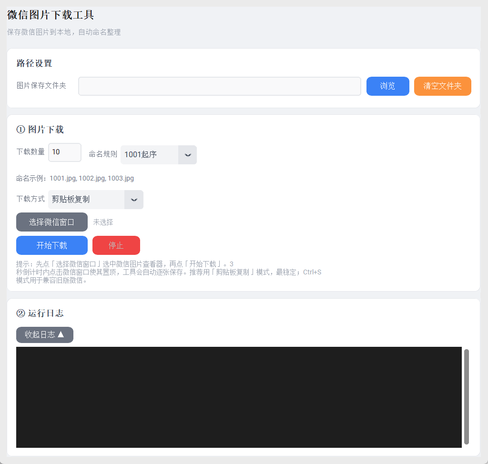

# WeChatImageTool · 微信图片批量下载工具

> 一键保存微信聊天图片到本地，自动命名、自动编号、支持窗口选择与多种命名规则。


**关键词**：微信图片下载、微信图片批量保存、WeChatImageDownloader、微信聊天记录图片导出、微信PC图片下载、微信图片自动命名、CustomTkinter、PyInstaller、剪贴板下载、Ctrl+S另存为、微信图片整理工具。

---

## 界面截图



---

## 功能特性

- **两种下载模式**
  - **剪贴板复制（推荐）**：模拟 `Ctrl + C` 读取微信图片查看器剪贴板内容，直接写入目标文件夹，绕过微信「另存为」对话框。
  - **Ctrl + S 接管**：自动识别微信「另存为」对话框，切换目录、填写文件名、用 `Alt + S` 提交保存；失败时自动从微信默认目录兜底搬移。
- **手动选择微信窗口**：避免工具自身抢焦点导致保存失败。
- **按会话自动分文件夹**：通过 UI Automation 读取当前图片所属群名/联系人名，自动在目标目录下建同名子文件夹（可关闭）。识别失败时自动回退到原目录。
- **写入拍摄/消息时间（可开关）**：下载后把文件修改时间与 Windows 创建时间写成真实拍摄时间（能取到 EXIF 时）或微信消息时间/推测时间，方便相册、资源管理器按时间排序。
- **6 种命名方案**：`文件日期`（默认）、`1001 起序`、`0001 起序`、`1 起序`、`日期 + 序号`、`自定义前缀 / 起始序号 / 位数`。
  - `文件日期`：按拍摄/消息时间命名成 `20261118_132514.jpg`，推测时间加 `_dst`（`20261118_132514_dst.jpg`）；同一秒重名自动加 `_2`、`_3`。
  - 其余方案自动顺延已有编号，避免覆盖旧文件。
- **运行日志可折叠**：日志区支持收起 / 展开，无需拖拽窗口边框。
- **日志带毫秒时间戳 + 落盘**：每条日志形如 `22:10:05.888 已保存 1001.jpg`，并同步写入本地 `logs/wechat_tool_YYYY-MM-DD.log`（按天分割，路径可在 `config.py` 的 `LOG_CONF` 修改），方便事后排障。
- **一键清空图片文件夹**：在路径设置右侧直接清空。
- **单文件 exe**：已用 PyInstaller 打包成 `WeChatImageTool.exe`，无需安装 Python 即可运行。

---

## 下载与安装

### 方式一：直接下载 exe（推荐）

从本仓库 [Releases](../../releases) 下载 `WeChatImageTool.exe`，双击运行即可。

> 仓库根目录 `dist/WeChatImageTool.exe` 即为最新构建版本。

### 方式二：源码运行

```bash
# 1. 克隆仓库
git clone https://github.com/lytssaa/WeChatImageTool.git
cd WeChatImageTool

# 2. 创建虚拟环境
python -m venv .venv
.venv\Scripts\activate          # Windows
# source .venv/bin/activate    # macOS/Linux

# 3. 安装依赖
pip install -r requirements.txt

# 4. 运行
python main.py
```

---

## 使用步骤

1. **设置图片保存文件夹**：点击「浏览」选择你要保存图片的目录。
2. **选择微信窗口**：点击「选择微信窗口」，从列表里选中微信图片查看器窗口（通常是「图片和视频」或聊天窗口）。
3. **配置下载参数**：下载数量、命名规则（默认「文件日期」）、下载方式。
4. **点击「开始下载」**：3 秒倒计时内，用鼠标点击微信图片查看器窗口使其置顶并保持焦点。
5. **工具自动逐张保存**，日志区实时显示进度。

> **提示**：日常推荐「剪贴板复制」模式，最稳定；「Ctrl + S」模式用于兼容旧版微信或剪贴板失效的场景。

---

## 核心原理

### 剪贴板复制模式

1. 用 `pywin32` 确认微信图片查看器在前台（不在前台时才置顶）。
2. 发送 `Ctrl + C` 把当前图片复制到系统剪贴板。
3. 调用 `PIL.ImageGrab.grabclipboard()` 读取位图；如果微信复制的是文件路径，则读取 `CF_HDROP` 列表。
4. 保存到目标文件夹，并按命名规则重命名。
5. 按 `→`（右方向键）切换到下一张，循环执行。

为了应对「切图后图片还没渲染完」的偶发竞态，单张图内部会**周期性重发 Ctrl + C 并轮询剪贴板**（最多 4 次，约 8 秒），只有真正抓不到才跳过继续。

**过期 / 被清理的图片**：查看器会显示「图片已过期或被清理」字样，且「保存」按钮会变灰（`IsEnabled=False`）。工具在按 Ctrl+C **之前**先用只读 UIA 检测这两类信号——**优先读取过期提示文字**（最可靠），读不到时回退到「保存」按钮状态，二次确认后直接跳过，省掉 4 次 Ctrl+C 重试的等待。读不到任何信号、或两次结果不一致（Qt 状态延迟）时一律照常复制，不会误跳正常图。收尾日志会汇总跳过数量（如「另有 12 张疑似过期被跳过」）。

> **类人操作节奏（降低风控风险）**：固定毫秒级间隔、每张图都强制置顶、每张都清空剪贴板，这些都是明显的脚本特征。工具改用**随机间隔**（0.15~3.5 秒的多个区间，节奏刻意偏慢）+ 小概率「发呆」停顿（12% 概率停 3~8 秒）；只在窗口确实不在前台时才抢焦点；**不再清空剪贴板**，而是用文件路径 + 图片指纹判断内容是否真的变化。目的是让操作序列更接近真人，避免触发微信「为了账号安全，请重新登录」这类服务端风控。即便如此，短时间导出整个会话仍有风险，建议分批（每批 20~30 张，间隔几分钟）而不是一次跑完。

### Ctrl + S 接管模式

1. 发送 `Ctrl + S` 调出微信「另存为」对话框。
2. 枚举类名为 `#32770` 的对话框，结合标题/控件启发式定位保存窗口。
3. 用 `Ctrl + L` 聚焦地址栏，粘贴目标文件夹路径并回车，**先把对话框当前目录切过去**。
4. 在文件名框只填 `1001.jpg` 这类 basename，再用 `Alt + S` 提交。
5. 如果对话框检测失败，启动兜底扫描：递归遍历 `WeChat Files` 下最近 15 秒修改过的图片文件，自动搬移到目标文件夹并重命名。

### 会话名识别（可选子文件夹）

微信 4.x 的 Qt 界面在 UI Automation 树里暴露了两条信息，工具只读不写：

1. `图片和视频` 查看器根节点的 `AutomationId` 形如
   `PreviewWindow_58144075979@chatroom_1794731750_25_0_0`，中间一段就是会话 ID（群聊以 `@chatroom` 结尾）。
2. 主窗口聊天输入框 `chat_input_field` 的 `Name` 是当前打开的会话名（群名或联系人名）。

工具用会话 ID 做缓存键、用会话名作为子文件夹名，并过滤 Windows 非法字符。

**名称识别方式**：查看器有会话 ID 但没有名字，主窗口有名字但没有 ID，两边无法直接匹配。所以工具只在**用户主动操作的两个时刻**读取主窗口当前选中的聊天名：

1. 点「选择微信窗口」选中「图片和视频」时
2. 点「重新识别」时

读到后按会话 ID 缓存，下载时只读缓存，不再读当前聊天。

**正确顺序**：在微信里把主窗口切到图片所属聊天 → 点「选择微信窗口」→ 点「开始下载」。

如果名字不对，两种方式纠正：

- 切到正确的聊天，再点「重新识别」，会重新读一次当前聊天名
- 或直接在「会话名」输入框里改，按会话 ID 保存在内存里，本次运行有效（重启后需重新识别）

把「会话名」清空后下载，图片会保存到原目录（不建子文件夹）。若名称始终读不到，工具也会回退到原目录，不影响下载。

> 工具与微信需要处于同一权限级别（都用普通身份或都用管理员）。如果工具以受限（低完整性）方式启动（例如从某些沙箱/受限终端启动），Windows 会禁止它读取微信的 UI Automation 树，日志会直接说明原因；请关闭后改为在资源管理器里双击 `WeChatImageTool.exe`，或用普通命令提示符运行。

> 所有路径/文件名都通过**剪贴板粘贴**写入，避免中文输入法下 `pyautogui.typewrite` 把 `\` 变成 `、`、数字缺失、中文乱码的问题。

### 拍摄/消息时间（可开关）

微信转发通常会抹掉真实拍摄时间，落盘图片还是加密的 `.dat`，无法还原原始 EXIF。工具按下面的证据链取「最可信」的时间，并同时写入文件的**修改时间**与 **Windows 创建时间**：

1. **EXIF 拍摄时间**：点「查看原图」时微信会把原图解码到 `temp\RWTemp\<当月>\<hash>.jpg`，原片的 EXIF 日期串仍在字节里，直接扫描即可得到真实拍摄时间。若某张图很重要，可先在查看器里点一下「查看原图」再下载。
2. **微信消息时间（估算）**：复制图片时微信会读取对应的 `.dat`，其访问时间被更新为当前；据此定位到具体那张，再取同一消息的 `.dat` / `_h.dat` / `_W.dat` / `_t.dat` / `_t_W.dat` 中**最早**的文件时间（缩略图通常随消息接收就落盘，最接近发送时间）。
3. **微信落盘时间（估算）**：视频等直接取落盘文件的创建/修改时间。
4. 都取不到时回退到下载时间。

> 实测微信查看器的 `AutomationId` 时间戳只在打开查看器时固定，切换图片**不会**变化，因此不能用来逐张定时间。每张实际使用的时间来源都会写在运行日志里，例如 `已写入时间：2026-11-18 13:25:14（消息时间估算·698889e9… _t 缩略图）`。

### 文件日期命名（默认）

命名规则选「文件日期」时，下载的照片/视频会用**该媒体的时间**做文件名：

| 场景 | 文件名示例 |
| --- | --- |
| 拿到真实 EXIF 拍摄时间 | `20261118_132514.jpg` |
| 推测时间（消息时间估算 / 落盘时间 / 月份推测 / 下载时间兜底） | `20261118_132514_dst.jpg` |
| 同一秒重名 | `20261118_132514_2.jpg`、`20261118_132514_dst_2.jpg` |

实现流程：保存对话框/剪贴板阶段还拿不到媒体时间，所以先以临时名（`_tmp000001_12345.jpg`）落盘 → 按上面的证据链取时间 → 写文件时间（可开关）→ 按时间重命名。取时间不受「写入拍摄/消息时间」开关影响，即使关掉写时间，`文件日期` 命名仍会去查时间。

> Windows 文件名不允许冒号，因此时间部分写作 `HHMMSS` 而不是 `HH:MM:SS`。时间来源是推测的会加 `_dst` 后缀，用来提示这不是真实拍摄时间。

---

## 项目结构

```
WeChatImageTool/
├── assets/
│   └── screenshot.png            # 项目截图
├── core/
│   ├── __init__.py
│   ├── downloader.py             # 下载核心：剪贴板/Ctrl+S/兜底搬移
│   ├── file_ops.py               # 文件夹创建、清空、索引计算
│   ├── media_time.py             # 拍摄/消息时间证据链与文件时间写入
│   ├── naming.py                 # 命名规则、文件日期命名与防覆盖
│   └── wechat_uia.py             # 读取微信会话 ID / 会话名，生成子文件夹名
├── gui/
│   ├── __init__.py
│   ├── app.py                    # 主界面与交互逻辑
│   ├── logging.py                # 日志着色输出 + 毫秒时间戳 + 本地文件同步
│   ├── utils.py                  # 通用 UI 工具函数
│   └── widgets.py                # 自定义卡片、文本框等控件
├── .gitignore
├── build.bat                     # Windows 一键打包脚本
├── config.py                     # 默认配置（路径、窗口大小等）
├── diag_dialog.py                # 调试：枚举保存对话框信息
├── dist/
│   └── WeChatImageTool.exe       # 打包后的单文件可执行程序
├── main.py                       # 入口文件
├── README.md                     # 本文件
└── requirements.txt              # Python 依赖
```

---

## 依赖

```
customtkinter>=5.2.0
Pillow>=9.0.0
pyautogui>=0.9.54
pywin32>=306
uiautomation>=2.0.0
pyinstaller>=6.0
```

详见 [`requirements.txt`](requirements.txt)。

---

## 打包 exe

```bash
# 在 Windows 下执行（已包含在 build.bat 中）
python -m PyInstaller --noconfirm --onefile --windowed \
  --name WeChatImageTool \
  --collect-all customtkinter \
  --collect-all uiautomation \
  --collect-all comtypes \
  --hidden-import win32com \
  --hidden-import pywin32 \
  --hidden-import pyautogui \
  --hidden-import win32clipboard \
  --hidden-import PIL.ImageGrab \
  main.py
```

打包产物位于 `dist/WeChatImageTool.exe`。

---

## 常见问题

**Q：点开始下载后保存 0 张？**  
A：请确保在倒计时结束前，用鼠标点击微信图片查看器窗口使其保持前台焦点。建议先点「选择微信窗口」手动指定。

**Q：Ctrl + S 模式保存到了其他目录？**  
A：工具会先尝试把「另存为」对话框切到目标文件夹再保存。如果微信版本特殊导致接管失败，会兜底从微信默认目录把最新图片搬过去。

**Q：日志区看不到/被挤没？**  
A：当前版本已把日志区用固定高度容器包裹，并支持「收起日志 / 展开日志」按钮。

**Q：某些图一直跳过？**  
A：动图、视频、表情包或需要点「查看原图」的大图可能无法通过 `Ctrl + C` 抓取，属于正常跳过。已过期 / 被微信清理的图，「保存」按钮会变灰，工具会提前识别并跳过（日志写「保存按钮不可用，疑似已过期」）。这些都是正常现象，不影响其它图片。

**Q：勾选了「按会话建子文件夹」，但图片还是放在根目录？**  
A：说明会话名为空，日志里会有 `未识别到微信图片查看器会话` 或 `名称尚未捕获`。请确认：① 选中的是「图片和视频」窗口；② 微信主窗口没有被关闭；③ 直接在「会话名」输入框里填写群名。识别失败不会影响下载，只是回退到原目录。

**Q：提示「未识别到」，按上面检查后仍然不行？**  
A：先看日志开头的权限提示。如果显示「工具正以受限（低完整性）方式运行」，说明工具是在受限终端/沙箱里启动的，Windows 会禁止它读取微信界面——关掉后改为在资源管理器里双击 `WeChatImageTool.exe`（或普通命令提示符运行）即可。也请确认微信和工具处于同一权限级别（不要一个管理员、一个普通）。若仍失败，日志会打印出工具与微信的窗口层级信息，可据此反馈给开发者。

**Q：日志里显示的群名和图片实际所属群不一致？**  
A：查看器只暴露会话 ID，不暴露会话名；工具读的是主窗口"当前选中的聊天名"。如果选窗口时主窗口停在别的聊天，就会读错。纠正方法：① 在微信里切到图片所属的聊天，再点「重新识别」；② 或直接在「会话名」输入框里改成正确的名字，工具会记住这个修正。

**Q：会话名带表情/特殊字符会出问题吗？**  
A：不会。工具会把 `\ / : * ? " < > |` 和控制字符替换成 `_`，并处理 Windows 保留名（如 `CON`）。表情符号在 NTFS 下可以正常作为文件夹名。

**Q：文件名里的 `_dst` 是什么意思？时间为什么没有冒号？**  
A：「文件日期」命名按拍摄/消息时间命名。只有 EXIF 拍摄时间是真实时间，其余来源（消息时间估算、落盘时间、月份推测、下载时间兜底）都算推测，会自动加 `_dst` 后缀。Windows 文件名不允许冒号，所以时间写作 `20261118_132514`。同一秒内重名会自动加 `_2`、`_3`，不会覆盖已有文件。

**Q：切换命名规则后，之前的编号会冲突吗？**  
A：不会。序号类方案会扫描目标文件夹里已有的编号自动顺延；「文件日期」方案按时间+重名后缀保证不覆盖。

---

## 免责声明

本工具仅用于**个人备份自己微信聊天记录中的图片**，请遵守相关法律法规与微信用户协议，不得用于爬取他人数据、批量下载非授权内容或任何违法用途。

---

## License

[MIT](LICENSE)
